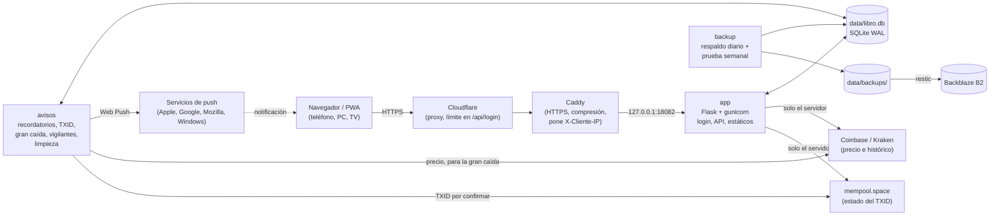

# Libro DCA (autoalojado)

Registro de compras DCA de Bitcoin con precio en vivo. Flask + SQLite en tu servidor, detrás de Caddy y Cloudflare, con login propio por persona.

Tu saldo en sats es una montaña que subes compra a compra: la cabecera es un paisaje que sigue la hora de El Salvador, con un campamento en cada potencia de 10 (100k, 1M, 10M…; la cima es siempre la siguiente, y al llegar la montaña se rehace con otra) y una celebración cuando cruzas una etapa. Debajo, el precio de BTC con tus compras marcadas y tu costo promedio, y reportes: constancia semanal, año por año, tu mejor y peor precio y «Tu historia», con cada etapa y su fecha. Anotas escribiendo solo los sats que recibiste, con el teclado numérico del teléfono (los dólares se calculan con el precio de ese día; si quieres, los escribes exactos); al tocar un movimiento de la lista se abre su comprobante, y desde ahí quien anota lo edita o lo anula. Importar y exportar CSV está en «Tu cuenta → Tus datos». Funciona igual de bien en el teléfono y en el PC.

## Arquitectura
Tres servicios con la misma imagen y la misma carpeta de datos (GitHub dibuja el diagrama solo):



- **La app** sirve la página (módulos ES sin build, con `?v=<hash>`), la API y el login. El navegador nunca habla con terceros: precio, histórico y estado de TXID los pide el servidor y los guarda en la base.
- **`backup`** copia la base cada 24 h (verificada), conserva 30 y una vez por semana prueba restaurar el último. **`avisos`** manda lo programado por Web Push y deja su marca de «sigo vivo»; los dos tienen su `healthcheck`.
- **Estado del sistema** (Tu cuenta, solo admin) junta lo que mira cada pieza: respaldo, avisos, integridad, disco, versión, errores, las medidas de los aparatos («Medir este aparato», abajo) y la fecha de tu última revisión del respaldo de la wallet («Revisado», ver «Avisos push»). El registro de la app sale en JSON (`docker compose logs app`).
- Lo que no se puede probar fuera del servidor (Caddy, Cloudflare, los servicios en marcha) se valida con `scripts/verificar-despliegue.sh`; la fluidez en el iPhone, con «Medir este aparato» (abajo). El CI sí construye y arranca la imagen de Docker.

## Qué necesitas
- Docker y Docker Compose en el servidor, y Caddy (u otro proxy) para HTTPS.
- Un dominio en Cloudflare (el plan gratis alcanza).

## Despliegue (Caddy + Cloudflare)

```bash
mkdir -p data && sudo chown -R 1000:1000 data     # el contenedor corre como uid 1000
cp .env.example .env
docker compose up -d --build
docker compose ps                                  # app en "healthy"
curl -s http://127.0.0.1:18082/healthz
```

La app solo escucha en `127.0.0.1:18082`. Publícala con tu Caddy:

```caddy
dca.tudominio.com {
	encode zstd gzip
	reverse_proxy 127.0.0.1:18082
}
```

Después, en Cloudflare: registro DNS con proxy (nube naranja), SSL/TLS en *Full (strict)* y una regla de límite de peticiones para las rutas que **empiezan por** `/api/login` (por ejemplo, 10 por minuto por IP): así cubre también `/api/login/codigo`, la entrada de la tele con un código. Añade también una regla de caché *Bypass cache* para el dominio (es obligatoria: la caché la deciden las cabeceras de la app, y sus estáticos ya van versionados) y activa HSTS (SSL/TLS → Edge Certificates → HTTP Strict Transport Security). En el firewall del servidor, el 443 solo para las IPs de Cloudflare: sin eso, entrar por la IP se salta Cloudflare. La protección de la app es su login propio (cuentas por persona, abajo); Cloudflare Access ya no se usa.

## Acceso con cuentas
La app tiene login propio: una cuenta por persona, **admin** (anota, corrige, anula, importa, ve el historial) o **lector** (ve todo, no escribe). Toda escritura queda en un historial que no se puede modificar, y borrar una compra la **anula** (sigue en el historial).

La primera vez, crea las cuentas:
```bash
docker compose exec backup python backup.py        # respaldo antes de nada
docker compose up -d --build                       # la app muestra «Aún no hay cuentas»
docker compose exec app python usuarios.py crear Daf3r --rol admin --generar
docker compose exec app python usuarios.py crear Ana --rol lector --generar
docker compose exec app python usuarios.py listar
```
Las contraseñas generadas son de 16 caracteres sin letras ambiguas (`xxxx-xxxx-xxxx-xxxx`); también puedes escribir una (mínimo 12) quitando `--generar`. Cada uno puede cambiar la suya desde la app (botón con su nombre → Cambiar contraseña).

Caddy debe decir a la app la IP real del visitante (solo así funciona el límite de intentos por IP). En el Caddyfile del servidor:
```caddy
dca.polarzero.dev {
	encode zstd gzip
	reverse_proxy 127.0.0.1:18082 {
		header_up X-Forwarded-Proto https
		header_up X-Cliente-IP {http.request.header.CF-Connecting-IP}
	}
}
```
`header_up` sobrescribe lo que mande el visitante, y el firewall solo deja llegar a Cloudflare, así que la cabecera es de fiar. Después: `sudo systemctl reload caddy`, descomenta `CONFIAR_X_CLIENTE_IP=1` en `.env` (viene comentada en `.env.example`) y `docker compose up -d`. Sin eso, la app avisa en el log y desactiva el límite por IP (el límite por cuenta sigue).

Probar: entra en el iPhone y en el PC, prueba un lector y revisa el Historial.

Otras órdenes: `usuarios.py clave NOMBRE` (cambia la contraseña y cierra sus sesiones), `desactivar`/`activar`, `cerrar-sesiones`, `desbloquear` (tras muchos intentos fallidos la cuenta espera hasta 15 min).

Si algo falla tras una actualización: despliega el commit anterior (`git checkout <commit> && docker compose up -d --build`). La base no estorba al código anterior (las migraciones solo añaden: ver «Migraciones de la base»), pero lo anotado con funciones nuevas puede verse distinto con él; si hace falta, restaura el respaldo de antes del despliegue (ver abajo).

## Respaldos (para no perder datos)
- El servicio `backup` copia la base cada 24 h a `data/backups/`, verifica cada copia con `PRAGMA integrity_check` y conserva las últimas 30.
- Copia manual: `docker compose exec backup python backup.py`
- **Una copia en el mismo disco no te salva si pierdes el servidor.** Saca copias fuera con `scripts/offsite.sh` (rclone hacia R2, Backblaze B2 u otra máquina) y prográmalo en cron. Los *backups automáticos* de Vultr cubren el servidor completo y se suman a esto.
- **Restaurar** (idea 48; el comando y la prueba están probados de verdad en `tests/test_api.py`: restauran un respaldo, comparan tabla por tabla y abren el resultado con la app):
  1. *Ensayo sin riesgo* (no toca nada): `docker compose exec backup python backup.py --restaurar` deja el último respaldo en `data/libro.restaurada.db` (o `--restaurar data/backups/libro-AAAAMMDD-HHMMSS.db`). Puedes abrirlo con `sqlite3` y mirar.
  2. *Recuperar de verdad* (la base real se dañó o se borró algo): primero para quien escribe, y después restaura encima. La base actual no se borra: se guarda junto a ella como `libro.db.antes-FECHA` (con su `-wal` y `-shm`).
```bash
docker compose stop app avisos
docker compose exec backup python backup.py --restaurar --a /data/libro.db --reemplazar
docker compose start app avisos
bash scripts/verificar-despliegue.sh
```
  3. Elige otro respaldo si el último ya traía el problema: añade su ruta tras `--restaurar` (están en `data/backups/`, uno por día). La app migra el esquema sola al arrancar (`esquema`: ver «Migraciones»).
  - El comando se niega (sale con 1 y no toca nada) si el archivo no es una base, no pasa `integrity_check` o le faltan las tablas clave.
  - La prueba semanal automática y `python backup.py --probar` siguen igual (comparan el último respaldo con la base real).

## Migraciones de la base
La base lleva su versión en la tabla `esquema` (`SELECT * FROM esquema;`). Al arrancar, `server.migrar` aplica en orden las migraciones que falten (`MIGRACIONES_ESQUEMA` en `app/server.py`), cada una **idempotente**, y dice en el registro cuáles aplicó (`docker compose logs app | grep esquema`). Una base de cualquier edad, con o sin esa tabla, llega al mismo estado; una base más nueva que el código (volviste a una versión anterior) sigue funcionando porque las migraciones solo añaden. Para cambiar la base: una migración nueva al final y su prueba (`tests/test_api.py`, «Migraciones versionadas»).

## Respaldos cifrados (opcional)
Los respaldos locales llevan los hashes de las contraseñas; restic ya cifra lo que sube a B2, pero los de `data/backups/` quedan en claro. Para cifrarlos pon una clave larga en el `.env` (`BACKUP_CLAVE=…`) y reinicia: `docker compose up -d backup`. Desde entonces cada copia es `libro-FECHA.db.cifrado` (AES-256-GCM, clave derivada con scrypt) y **no queda copia en claro**; el respaldo se descifra de vuelta y se compara antes de borrar la copia en claro. Los respaldos viejos en claro siguen ahí (conviven, la retención cuenta todos); bórralos tú cuando quieras. `backup.py --restaurar` y `--probar` leen la misma variable. **Si pierdes la clave, esos respaldos no se pueden abrir**: guárdala aparte. Por eso es opcional.

## Modo solo lectura de emergencia
Para un mantenimiento, o si sospechas de un problema y quieres revisarlo sin que nadie escriba: pon `SOLO_LECTURA=1` en el `.env` y `docker compose up -d app`. Todo se sigue viendo (saldo, gráficos, lista, estado del sistema), la gente puede entrar y salir, pero **ninguna escritura entra** (responde 503) y arriba sale «Mantenimiento: por ahora solo se puede mirar». Para volver a la normalidad quita la línea (o ponla en 0) y `docker compose up -d app`. El servicio `avisos` y los respaldos no se detienen.

## Enlace de solo lectura para una hoja de cálculo
«Tu cuenta → Enlace para tu hoja de cálculo» (solo el admin) crea un enlace que Google Sheets (`=IMPORTDATA("…")`) o Excel leen **sin iniciar sesión**: da solo las compras y los traslados en CSV, nunca escribe ni ve cuentas. El enlace se muestra **una sola vez** (en la base solo queda su huella), puedes tener hasta 5 y revocar cualquiera al instante. **Es una llave:** la dirección completa viaja en la petición, así que puede quedar en los registros de Caddy o de Cloudflare; no la pegues en chats ni en documentos que otros vean. Si Cloudflare tiene reglas de bots muy estrictas, Google Sheets puede no llegar: prueba el enlace en la hoja tras crearlo.

## La tele de la sala
El **modo pantalla grande** («Tu cuenta → Modo pantalla grande», o abrir la dirección con `#tv`) deja la montaña, el saldo, el último movimiento y un reloj a pantalla completa, sin controles. Se actualiza sola cada minuto, celebra una compra nueva, de 11 de la noche a 5 de la mañana se queda casi a oscuras (en ese aparato se puede dejar despierta: «La tele duerme de noche: no») y cada diez minutos enseña un rato un dibujo de «Tu historia».

Conectar una tele, sin teclear usuario ni contraseña con el control remoto:
1. Hace falta una cuenta **de solo lectura** para la tele (la de alguien de la familia o una propia: `docker compose exec app python usuarios.py crear Sala --rol lector --generar`). Con una cuenta que anota no se puede: desde la sala se podría escribir.
2. En tu teléfono (el admin): «Tu cuenta → Sesiones abiertas → Conectar una tele», elige la cuenta y «Crear código». Sale un código de 8 cifras **una sola vez**.
3. En la tele, abre `https://dca.tudominio.com/login#tv` (o «Entrar con un código» en la entrada) y escribe las 8 cifras. Entra y queda en pantalla grande.

El código caduca a los 5 minutos, sirve una vez, crear otro anula el anterior y 5 intentos fallidos lo anulan (se crea otro y listo). La sesión de la tele es la normal (90 días que se renuevan con el uso) y aparece en las «Sesiones abiertas» de esa cuenta como «Tele · …», desde donde se cierra. El historial anota quién creó cada código y cuándo entró la tele, nunca el código. Con `SOLO_LECTURA=1` la tele puede entrar con un código, pero no se pueden crear códigos nuevos.

## La fiesta del hito (y el halving)
Al anotar una compra que cruza **por primera vez** un campamento o una etapa, el pueblo de la montaña hace fiesta (campana, osos en la plaza, farolitos y cohetes: 24 s un campamento, 12 s una etapa principal, 6 s una intermedia). La ve toda la familia ese día, una vez en cada aparato (también la tele y quien solo mira), y queda un farol encendido en la plaza hasta la medianoche. Un toque la salta. Que una etapa ya tuvo su fiesta lo guarda el servidor (tabla `hitos_celebrados`, migración 19: la etapa, el día y la compra; **nunca quién la vio ni cuándo se abrió la app**); anular la compra la suelta. Detalle: `docs/campamentos/59-la-fiesta-del-hito.md`.

**El halving**: la app aún no sabe en qué bloque va la red (eso llegará con el nodo, campamento 60), así que no adivina la fecha. Cuando se sepa con certeza (unos días antes del bloque 1,050,000, hacia abril de 2028), pon `HALVING_FECHA=AAAA-MM-DD` en el `.env` y `docker compose up -d app`: ese día el pueblo hace su fiesta (sin «Tú»: es un hecho de la red, no un logro del libro). Sin la variable no pasa nada; una fecha mal escrita se ignora. En «Probar la celebración» está el botón «Halving» para verla antes.

## Medir este aparato (¿va fluida en el iPhone?)
En «Tu cuenta → Estado del sistema» (solo el admin), **«Medir este aparato»** abre la app en `/medir`: dice cuánto tardó en verse el saldo y, con «Empezar la prueba», tras una cuenta atrás la página baja y sube sola durante 7 segundos mientras cuenta los fotogramas por segundo. La medida se guarda (las últimas 50, sin la cuenta ni la IP: solo números, los ajustes de la pantalla y «Safari · iPhone») y sale en esa misma vista como **Fluido** (55 o más), **Revisar** (de 50 a 55) o **Lento** (menos de 50).
- Mídelo en el iPhone, con la app instalada y **sin el modo de ahorro de batería** (limita la pantalla a 30 fotogramas y la medida sale como «Revisar», no como «Lento»). No toques la pantalla durante la prueba: un toque la detiene.
- Si en el iPhone sale «Lento», mide también en Safari `/medir?sin=pausa`, `/medir?sin=velo` y `/medir?sin=capas`: cada una apaga una mejora de la escena y así se ve qué parte pesa (`/medir?sin=` vuelve a medir con todo). El desenfoque de la sierra del fondo ya no va en el teléfono y la escena ya se pinta en capas.
- Con `SOLO_LECTURA=1` se puede medir, pero la medida no se guarda.

## Importar y exportar
Están en **«Tu cuenta → Tus datos: descargar e importar»** (solo el admin). *Exportar compras (CSV)* descarga todas las compras (`fecha,monto_usd,precio_btc_usd,sats,btc`). *Importar compras (CSV)* acepta ese mismo formato o uno viejo sin `sats` (usa `precio_btc_usd`). Salta filas repetidas e inválidas y dice cuáles, así que puedes importar el mismo archivo dos veces sin duplicar.

Desde el servidor, para archivos grandes (la página acepta hasta 1 MB):
```bash
docker compose run --rm --no-deps -v "$PWD/compras.csv:/import/compras.csv:ro" app python importar.py /import/compras.csv
```

## Más rápido: compresión y fuentes
Sin comprimir, el CSS pesa unos 390 KB y los 66 archivos de JavaScript unos 940 KB; comprimidos, unos 94 KB y 340 KB (medido en el repo el 18 nov 2026). **Caddy comprime** con una sola línea, `encode zstd gzip`, dentro del bloque del sitio (ya está en los ejemplos de arriba; tras añadirla, `sudo systemctl reload caddy`). Mide antes y después con `bash scripts/medir-carga.sh https://dca.tudominio.com`: baja lo que pide la entrada con y sin compresión y dice el ahorro (esperable: más de la mitad). `DOMINIO=dca.tudominio.com bash scripts/verificar-despliegue.sh` comprueba también que llega comprimido. Las fuentes (Fraunces y Bricolage) ya se piden por adelantado (`<link rel="preload">`) y los recursos con versión van `immutable`, así que la segunda visita casi no descarga nada. Cloudflare comprime por su cuenta lo que pasa por él; la línea de Caddy cubre el tramo hasta Cloudflare y las pruebas directas.

## Actualizar
Copia los archivos nuevos y ejecuta:
```bash
export VERSION_GIT=$(git rev-parse --short HEAD)   # opcional: así «Estado del sistema» dice qué commit está desplegado
docker compose up -d --build
```
Los datos viven en `./data` y no se tocan. Sin `VERSION_GIT` todo funciona igual; solo que «Versión» no mostrará el commit. Cada PR mezclado a `main` genera una **versión** en GitHub (Releases, `v2026.11.11-N`) con el título del PR y su descripción: ahí ves qué trae cada cambio y qué commit corresponde a cada una.

## Notas de seguridad
- Ningún servicio publica puertos; los contenedores van en solo lectura, sin capabilities y con `no-new-privileges`.
- La app autentica con cuentas propias (scrypt, sesiones con cookie `__Host-` `HttpOnly; Secure; SameSite=Lax`, límite de intentos, roles comprobados en el servidor) y aun así solo escucha en localhost detrás de Caddy y Cloudflare.
- Los respaldos contienen hashes de contraseña: guárdalos cifrados (restic ya cifra). Las sesiones solo se guardan como hash del token, inservibles para entrar.
- Las cabeceras CSP limitan la página a su propio origen, sin scripts ni estilos inline. Las únicas fuentes web (Fraunces y Bricolage Grotesque, licencias OFL en `app/static/fonts/`) van dentro del repo: el navegador no llama a ningún tercero.
- Las escrituras rechazan peticiones marcadas por el navegador como de otro sitio (`Sec-Fetch-Site`), y la importación exige `text/csv`, que obliga a un preflight CORS.
- El precio y el histórico los consulta el servidor (Coinbase, con Kraken de reserva). El precio se guarda 30 s; el histórico diario se guarda en la base (tabla `precios`) y se actualiza como mucho una vez al día, en segundo plano. El navegador nunca habla con terceros.

## Pruebas
- `python tests/test_api.py` (necesita Flask; base temporal, exchanges simulados, sin red): API completa, validaciones, CSV, migración, precio e histórico, y el acceso: sesiones, roles, fuerza bruta, auditoría inmutable y acotada, anular y la CLI de cuentas.
- `node tests/test_lib.mjs`: cálculos del frontend (hitos, racha con casos límite, proyección, «hoy» de El Salvador, borde de husos horarios, decimación).
- `node tests/test_ui.mjs`: prueba de navegador (Playwright + Chromium) contra un servidor de pruebas con base temporal y exchanges simulados (`tests/servidor_prueba.py`). Instala una vez con `npm ci --prefix tests` y `npx --prefix tests playwright install chromium`. Comprueba el saldo (sats y BTC, de 320 a 2560 px), los gráficos, el tema, anotar una compra con sus avisos, y lo que ve un lector.
- **CI en GitHub**: cada PR y cada cambio a `main` corren ocho trabajos (`.github/workflows/pruebas.yml`): API y cálculos (con ruff y mypy), JavaScript (Biome y los tipos de `lib.js`), navegador, accesibilidad (axe), rendimiento (Lighthouse), la imagen de Docker y, de forma informativa, dependencias y regresión visual (ver «Revisión del código»). Dependabot propone una vez al mes actualizaciones (pip, Docker, GitHub Actions y npm); revisa que el PR esté en verde antes de mezclarlo.
- La integración con Caddy y Cloudflare se valida en el servidor (`scripts/verificar-despliegue.sh`); la imagen de Docker ya la construye y arranca el CI.

## TXID y auditoría de las compras
Cada compra puede llevar su **TXID** (64 caracteres hexadecimales, o pega el enlace de mempool.space y se extrae solo): en «Más detalles» de la hoja de anotar. Con TXID, la lista muestra «Ver en mempool.space» (abre `https://mempool.space/tx/<txid>` en otra pestaña) para que cualquiera de la familia compruebe la transacción. Es opcional: una compra dentro del exchange o por Lightning no tiene. Si un TXID ya está en otra compra, se guarda y se avisa. El CSV de exportación incluye la columna `txid` y el importador la lee. Los cambios de TXID quedan en la auditoría como cualquier edición.

**Verificación contra mempool.space.** Bajo cada TXID la lista muestra su estado («Confirmada · N confirmaciones · comisión X sats», «Pendiente de confirmar», «No encontrada»). Lo consulta **el servidor** (`GET /api/tx/<txid>`; el navegador nunca habla con mempool.space, así que la CSP no cambia) y solo para TXID que están en una compra vigente, para que no sirva de proxy abierto. Las confirmadas se guardan para siempre en la tabla `tx_cache` (se crea sola); pendientes y no encontradas se reconsultan pasados 60 s; si mempool.space no responde se sirve lo guardado marcado como «dato guardado». Es informativo: no bloquea guardar nada.

**Probar la celebración (solo admin).** En «Tu cuenta → Estado del sistema», al final, seis botones (Compra, Etapa, Etapa con sello, Hito grande, 1 BTC y Constancia) reproducen la animación con datos de prueba, sin guardar nada ni dejar rastro en el Historial. Sirve para ver la celebración después de un cambio.

**«Tu cuenta» por grupos.** *El libro* (la historia y sus medallas, el nombre de la montaña y tu cumpleaños), *Este dispositivo* (avisos, tema, letra, contraste, efectos y lo demás que solo vale en ese aparato) y *Administrar* (contraseña y sesiones de cada quien; para el admin, además, el Historial, tus datos, el enlace para la hoja de cálculo y el estado del sistema). Al final, Salir.

## Ventas y gastos
Además de compras, puedes registrar **ventas o gastos** (un gasto cuenta como venta): en la hoja de anotar, elige «Venta o gasto», escribe los sats que salieron y, si quieres, una nota («gasté en renta»). Los dólares se estiman con el precio de ese momento (o los escribes exactos en «Más detalles»). El saldo nunca puede quedar negativo: el servidor rechaza una venta de más sats de los que tenías a esa fecha, y también anular o editar una compra si eso dejara sin sats a una venta posterior. La cuenta usa el **costo promedio ponderado**: al vender, el costo de lo que te queda baja en proporción y la ganancia realizada es lo recibido menos ese costo (sin impuestos). La tarjeta «Ganancia» muestra la realizada, la no realizada, el total y el invertido neto. El CSV exporta `tipo` y `nota`; un CSV viejo sin esas columnas se sigue importando como compras. Todos, también los lectores, ven las ventas.

## Metas intermedias
Además de los campamentos grandes de la montaña (100k, 1M, 10M, 1 BTC), la tarjeta «Próxima etapa» y la tarjeta «Siguiente paso» usan etapas intermedias, más juntas desde el campamento 21: 100k, después cada 250k hasta 2.5M, cada 500k hasta 5M, cada 1M hasta 10M, y así ×10 (cada 2.5M hasta 25M…). Las «de siempre» (250k, 500k, 2.5M, 5M…) llevan sello de lacre y la celebración completa; las demás se celebran en ligero. Al guardar una compra, el aviso dice cuánto avanzaste hacia la siguiente etapa («+32,500 sats · 69 % del camino a 250k»). La misma escalera está en `app/static/lib.js` y en `app/ritmo.py` (avisos), y `tests/test_api.py` comprueba que coinciden.

## Novedades al abrir la web
Quien entra con una cuenta de lector ve, la primera vez que abre la web, un resumen de lo que pasó desde su última visita: las compras o ventas nuevas, el saldo, lo que vale hoy, la ganancia, el avance hacia la siguiente meta y la racha. Si no pasó nada, no sale nada. La primera vez es una bienvenida con los últimos movimientos. Al cerrarlo, el servidor guarda la visita de esa persona, así que vale igual en el móvil y en el PC. No hace falta ningún canal externo: como se compra una vez por semana o por quincena, basta con que lo vean al entrar.

## Pestañas, el dock y «Tu historia»
Debajo de la montaña hay cuatro pestañas (Resumen, Gráficos, Historia y Movimientos; en «Tu cuenta → Pantalla» se puede volver a la página larga de antes). En el teléfono y la tablet van en una barra fija abajo, al alcance del pulgar, y «Anotar» es el botón naranja de su centro; tocar una pestaña enseña su contenido desde el principio y tocar la que ya estás sube a la montaña. En la computadora la barra va arriba y «Anotar compra» a la derecha. «Tu historia» abre con un dibujo distinto cada día (entre los que ya se ven bien con tus compras) y el resto va plegado con su cuenta; en el primer año del libro, el tronco crece por meses y la manta se teje en el telar.

## Instalar en el iPhone (PWA)
En Safari abre `https://dca.polarzero.dev`, toca **Compartir → Añadir a pantalla de inicio**. Queda con su icono y sin la barra de Safari. En Android (Chrome): menú → «Instalar app». Notas:
- La app instalada en iPhone **no comparte las cookies de Safari**: la primera vez hay que entrar de nuevo. La sesión dura 90 días deslizantes.
- No hay modo sin conexión a propósito: el único service worker (`sw.js`) solo recibe avisos, sin caché, así que nunca se sirve un módulo (`app.js` y los que importa) viejo tras actualizar.
- El manifiesto (`/manifest.webmanifest`) y los iconos son públicos, porque el navegador los pide sin cookie. Los iconos PNG salen de `icon.svg` (el de Apple va a sangre completa y el «maskable» con margen).
- La barra de estado es la opaca (`black`). Si se quiere que la montaña llegue hasta arriba, cambiar a `black-translucent` en `index.html` y añadir `env(safe-area-inset-top)` a la cabecera; probar en el iPhone antes.

## Recordatorio «te toca comprar» y hitos de constancia
Solo el admin ve, bajo la montaña, una línea según su ritmo (semanal o quincenal, el que marcan sus últimas compras): «Al día», «Te toca comprar esta semana», «Hoy es el último día…» o «Tu racha se reinició» (sin reproche). Si activas los avisos, el recordatorio llega también como notificación (ver «Avisos push»). Además, al anotar la compra 10, 25, 50, 100… o al cumplir 6 meses, 1 año… desde la primera compra, sale una tarjeta «Constancia» y el reporte de Constancia dice cuánto falta para el siguiente hito. No hay cambios de base de datos.

Cuando el precio cae 15 % o más frente a su máximo de 30 días, el admin ve una tarjeta opcional con el dato y con qué haría «reponer» (una compra como las tuyas) en el costo promedio. Es solo información: no recomienda comprar, y «Ocultar hoy» la quita hasta mañana.

Toca la cifra del saldo para verla en sats o en BTC (se recuerda en cada dispositivo). Bajo el título del gráfico, una línea dice con qué precio de BTC estarías en cero. La cotización muestra hace cuánto se actualizó el precio, y la hoja de anotar enseña a cuántos sats equivale hoy una compra como las tuyas.

Bajo el gráfico de precio, «Lo que pusiste y lo que vale» compara, día a día desde tu primera compra, lo invertido (neto de ventas) con lo que valía tu saldo cada día. Sale desde 3 compras y cuando hay histórico de precios; pasa el dedo o usa las flechas para leer un día.

En «Tu cuenta», el botón «Tema» elige entre automático (como el teléfono), claro y oscuro; se recuerda en cada dispositivo y también se aplica en la pantalla de entrada.

**Compra extra por una caída.** Al anotar una compra, en «Más detalles» puedes marcarla como *extra*; la nota (por ejemplo, por qué la hiciste) va en «¿Qué pasó esta semana en casa?», a la vista en la hoja como en cualquier compra. Las extra se ven aparte en la lista y no cuentan como tu ritmo habitual: no desvían la «compra como las tuyas», los avisos ni la proyección. Sí suman al saldo y al costo promedio. El CSV de exportación lleva una columna `extra` al final (`1` en las extra); un CSV antiguo sin esa columna se importa igual. La base se actualiza sola al desplegar (columna nueva en `compras`): haz antes el respaldo de siempre.

Bajo «Lo que pusiste y lo que vale», una línea compara tu costo promedio con el precio promedio de BTC desde tu primera compra. Comprar los mismos dólares cada vez compra más sats cuando el precio baja, así que el costo suele quedar por debajo del promedio: es el efecto del DCA, medido con tus datos. Sale desde 3 compras y con al menos 14 días de histórico.

## Dónde están tus sats (traslados)
Tu saldo cuenta cuántos sats tienes en total, sin importar dónde estén. Para ver cuánto sigue en el exchange y cuánto ya está en tu wallet, anota un **Traslado** (tercer botón de «Anotar»): los sats que **llegaron** a tu wallet, la fecha y, si quieres, el TXID. La tarjeta «Dónde están tus sats» muestra la barra y los porcentajes, y la ven también tus papás. Un traslado **no cambia tu saldo ni tu costo promedio**.
- Si pagaste comisión de red, escríbela en «Más detalles»: se anota además como un gasto («Comisión de retiro») y baja tu saldo en esa cantidad.
- Si algún día vendes o gastas desde la wallet, antes anota un traslado «De mi wallet al exchange».
- Un traslado no se edita: tócalo en la lista para abrir su comprobante, anúlalo desde ahí (queda en el historial) y vuelve a anotarlo bien.
- **Varias wallets:** al anotar un traslado, «Usar otra wallet…» (o el selector, si ya tienes más de una) crea y elige la wallet; la tarjeta las reparte con sus nombres (hasta 5 además de «Mi wallet»). Cada wallet se valida por separado: no se saca de una lo que hay en otra. En «Tu cuenta → Tus datos» puedes archivar las que ya no uses (solo si están vacías; sus traslados se conservan).
- Los traslados van en `traslados.csv` (con una columna `wallet`; vacía = «Mi wallet») y en los respaldos de la base. Las tablas nuevas se crean solas al desplegar: haz antes el respaldo de siempre.

## Revisión del código
El CI revisa en cada PR: Python con `ruff` y `mypy`, el JavaScript con Biome (y los tipos de `lib.js` con `tsc`), la app en un navegador real (Playwright), la **accesibilidad** con axe (falla ante cualquier violación), el **rendimiento** con Lighthouse, que la **imagen de Docker** se construye y arranca, y, de forma informativa, vulnerabilidades conocidas (pip-audit, npm audit, Trivy) y cambios visuales contra una referencia de `main`. Cada lunes, `semanal.yml` corre el barrido visual completo y las revisiones de seguridad sin tolerancia: si algo falla, GitHub te avisa por correo.

En tu computadora, antes de subir algo:
```bash
python tests/test_api.py && node tests/test_lib.mjs
npx --prefix tests biome lint
node tests/auditoria_axe.mjs
node tests/barrido_ui.mjs rapido
```
(`pre-commit install` hace las revisiones rápidas solas en cada commit.)

**Después de desplegar** (en el servidor): `bash scripts/verificar-despliegue.sh`. Comprueba en segundos que los tres servicios están en marcha, que la app responde, que la base pasa su revisión de integridad, que hay un respaldo reciente y que el servicio de avisos está vivo, y te dice qué falló si algo no está bien. Con `DOMINIO=dca.tudominio.com` mira además lo que llega de verdad por Cloudflare: que se comprime, que `/login` trae la CSP de la app, que hay HSTS y que ni `/` ni `/api/estado` salen de la caché de Cloudflare (la regla *Bypass cache*); cada fallo dice qué tocar.

**Restauración de prueba:** cada semana, el servicio de respaldos restaura el último respaldo en una carpeta temporal y lo compara con la base real (integridad, tablas, filas y la auditoría); si algo no cuadra, te avisa por push. Puedes pedirla cuando quieras con `docker compose exec backup python backup.py --probar`.

**Vigilantes de los servicios:** el servicio `avisos` te avisa por push (categoría «Fallo del respaldo») si pasan más de 36 horas sin un respaldo nuevo, si la revisión semanal de la base encuentra un problema o si queda poco espacio en disco. Además, `docker compose ps` muestra si `backup` y `avisos` están `healthy`.

## Avisos push
Cada persona activa los avisos **en su dispositivo**: «Tu cuenta» → «Avisos en este dispositivo» → «Activar», y marca cuáles quiere.
- **Al entrar:** la primera vez en cada dispositivo sale una tarjeta «¿Quieres recibir avisos?» (a tus papás, después de su bienvenida). Si dices «Ahora no», no vuelve a preguntar; siempre puedes activarlos en «Tu cuenta».
- **Tus papás (lectores):** un aviso por cada compra, venta o gasto nuevo (encendido) y, si quieren, por etapas, hitos y constancia (apagado por defecto).
- **Tú (admin):** recordatorio unos días antes de que venza tu semana o quincena (viernes a domingo, una vez al día, y solo si aún no compraste), TXID confirmado, fallo del respaldo y **gran caída** (BTC 15 % o más bajo su máximo de 30 días: un aviso por caída, solo informa; se reinicia cuando BTC queda a menos de 10 % de su máximo).
- **El Diario del domingo (todos, apagado por defecto):** el domingo a las 18:00 llega el titular del Diario del Libro, **sin cifras** (una notificación se lee en la pantalla bloqueada). Una vez por domingo; si a esa hora los avisos de ese dispositivo duermen, llega cuando despierten. Sin compras no hay Diario ni aviso.
- **Piedritas y firmas de tu familia (tú):** cuando alguien deja una piedrita en una compra o firma por primera vez el libro de cumbre de un campamento (reescribir una firma no avisa).
- **No suenan de noche** (por defecto, solo de 8:00 a 21:00, hora de El Salvador; cada dispositivo puede elegir su horario en esa misma vista): lo de la noche sale por la mañana.
- **Aviso de prueba:** el botón «Enviarme un aviso de prueba» manda uno solo a ese dispositivo y te dice en palabras si algo falló (máximo uno cada 30 s).
- **Botón «Anotar compra»** en el recordatorio (Android y computadora; en iPhone la notificación solo abre la app).
- **Retirar a tu wallet (opcional, apagado):** elige un monto en sats y te recordamos una vez cuando en el exchange haya más de ese monto. Solo es un recordatorio; la app no sugiere cuánto.
- **Revisión tranquila del respaldo (tú, apagado por defecto):** cada 180 días, una pregunta: «¿Tu respaldo de la wallet y la nota para tu familia siguen donde los dejaste?». Cuando lo mires, toca **«Revisado»** en «Tu cuenta → Estado del sistema» (ahí se ve también la fecha de tu última revisión y la del próximo recordatorio). Cuenta desde tu última revisión (o desde el último aviso, si es más reciente: nunca más de uno cada 180 días); si nunca has tocado «Revisado», desde el día en que lo encendiste, así que no suena ni el día del despliegue ni el que lo enciendes. **La app no pide ni guarda la frase ni nada de la wallet**: solo la fecha en que tocaste «Revisado».
- **iPhone:** los avisos solo funcionan con la app instalada en la pantalla de inicio (iOS 16.4 o más). Ábrela desde ahí y actívalos.
- **Al desplegar:** `docker compose up -d --build` crea el servicio nuevo `avisos` y la clave `data/vapid_private.pem`. **No borres esa clave**: si se pierde, cada dispositivo tiene que activar los avisos otra vez. Inclúyela en el respaldo de la carpeta `data`.
- **Brave:** trae los avisos apagados. En `brave://settings/privacy` activa «Usar servicios de Google para mensajes push» (en inglés, «Use Google services for push messaging»), reinicia Brave y vuelve a activar los avisos. En Chrome, Edge, Firefox y Safari no hace falta.
- Si algo no llega: `docker compose logs avisos` y `docker compose logs app`; en el teléfono, revisa que la app tenga permiso de notificaciones.

