# Campamento 53A · La neblina de la mañana

Reglas vigentes e índice: [CLAUDE.md](../../CLAUDE.md). Rehace el «mar de niebla» del [22B](22b-valle-vivo-parte-2.md) (idea 55). Antes de tocar la escena: [docs/escena.md](../escena.md) y [docs/rendimiento.md](../rendimiento.md).

## El pedido
El dueño mandó una captura del pueblo de mañana y preguntó: «¿no hay alguna mejor manera de representar la neblina?». Tenía razón. El mar de niebla del 22B eran **planos opacos de borde festoneado** (una cresta clara, el cuerpo y una sombra) más dos velos sobre los campos del pueblo: a tamaño real se leían como nubes recortadas en cartulina rosada que **cortaban** las colinas, los pinos y las casas. Lo opaco era una decisión del 22B («la translúcida se leía como un velo pegado»): una transparencia pareja, sin forma, tampoco parece niebla. Lo que faltaba no era opacidad sino **gradación**: la niebla es espesa abajo y se deshace hacia arriba.

Durante el trabajo el dueño afinó el criterio, con una captura de una versión intermedia (la del montículo, abajo):
1. Que se vea **clara** (nítida en su forma y su color, sin manchas turbias ni rosadas) y **no «montada»** sobre casas, árboles, vecinos, iglesia, teleférico ni colinas: en su plano, detrás de lo que está al frente y delante de lo lejano.
2. Las bandas largas del fondo, detrás de la montaña, **sí**; la bruma sobre el pueblo, **no** (lavaba tejados e iglesia y su borde cortaba contra el bosque).
3. **El suelo no se toca**: conserva su verde, su textura y la luz de la hora; la niebla se queda en el aire.

## Lo hecho (25 nov 2026)
- **Dos bancos, los dos detrás de la montaña**, en los huecos del dibujo que ya había (`#m-v-fondo`; nada cambia de orden): detrás de la loma del cantón (`.v-mar-atras`: vela el pie de las sierras lejanas, y los pinos de la loma se recortan nítidos contra ella) y delante de su falda, entero por debajo de la milpa como en el 22B (`.v-mar-frente`: no vela la loma). La profundidad se lee porque lo lejano queda velado y lo cercano, limpio.
- **En el pueblo no hay niebla.** Se quitaron los dos velos del 22B que cubrían los campos (`arte-pueblo.js: campos`). El pueblo (casas, iglesia, vecinos, teleférico), el bosque de las compras, el lago y **todo el suelo** se ven como a cualquier otra hora, con la neblina detrás.
- **Cada banco es un `<rect>`** (`arte-valle.js: marDeNiebla`) relleno desde el CSS con **un solo degradado**, `#m-v-mar` (`montana.js`): un `radialGradient` en unidades de la caja, con el centro en mitad de la base y estirado al doble hacia arriba (`gradientTransform`), o sea medio óvalo apoyado en la base del rectángulo. Espeso abajo (95 %), todavía denso al 80 % del radio (84 %, ya del color de la luz) y **nada en el borde de arriba**: ningún borde, y sin `filter`, `blur` ni `mix-blend-mode`; el degradado hace el suavizado. Los rectángulos miden **seis anchos de escena**, así que dentro de la pantalla el fundido es casi vertical (el lomo del óvalo apenas se curva: el de atrás sube un poco más a la izquierda, el de delante a la derecha) y llegan al pie de la escena (lo de abajo lo tapan la montaña, la loma y el llano).
- **El color, más claro**: `--v-niebla` y `--v-niebla-luz` llevan ahora un 9 % y un 12 % del cielo de la hora (`--c3`, `--c2`; antes 24 % y 30 %) sobre un blanco cálido. Antes, al amanecer, era rosada.
- **Se levanta por orden**, solo con `--v-mar` (cielo.js, sin tocar: 5:00 a 7:30) y `opacity`: el banco de atrás sigue `--v-mar` y el de delante, `min(1, --v-mar × 1.5)` (el de más cerca se forma antes y tarda más en irse). La transición de 4 s de siempre. **Quieta**: no es una animación, no entra en `FOCOS` ni cuenta como ambiental; se ve con cualquier nivel de efectos y en la entrada (es la hora, no un adorno).
- **Un nodo menos**: antes 7 trazos (2 + 3 en el fondo y 2 en el pueblo); ahora 2 rectángulos y el degradado con sus 3 paradas (4). Las `declara` del banco no se mueven.
- La niebla de ambiente de siempre (`.niebla`, dos bandas que se mueven con «todos») no se tocó.

## Lo que se probó
En el navegador y sobre la escena real (6:00 del 10 de febrero, con el maquilishuat en flor como en la captura del dueño). Capturas en [docs/pulido-visual/neblina/](../pulido-visual/neblina/).

| | Qué es | Qué pasó |
|---|---|---|
| Antes | planos opacos festoneados | 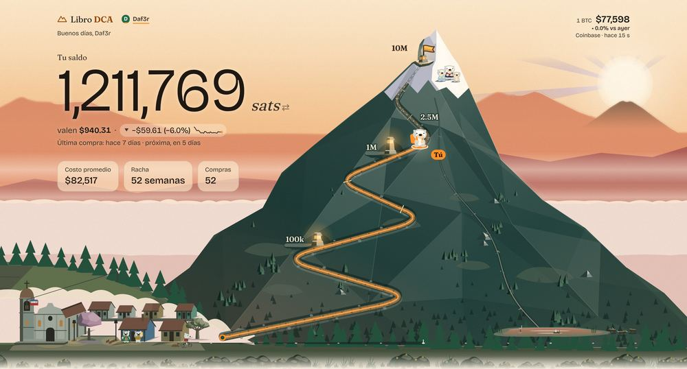 |
| A · bandas por profundidad | tres bandas (fondo, falda y pueblo), cada una un degradado vertical | Las del fondo son las que mejor se leen como niebla. La del pueblo es un rectángulo: **corta en vertical** contra la montaña y lava los campos. 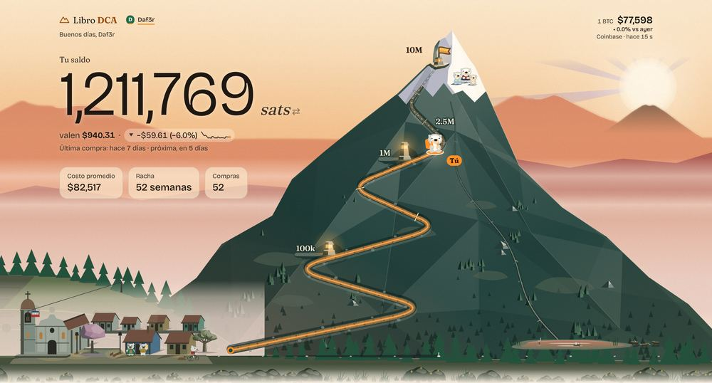 |
| B · jirones de la hondonada | óvalos con degradado radial sobre el lago, el pie de la loma y el pueblo | Suaves, pero ralos: no llenan el valle, y el del pueblo queda encima de las casas de atrás. Dos nodos más. 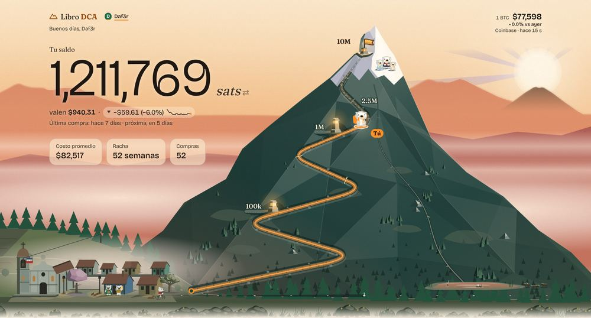 |
| C · el color del cielo | las bandas de A, altas y ralas, del color del horizonte (`--c3` y `--nube`) | **No se ve**: niebla del color del cielo sobre el cielo es un cielo un poco más rosado. La niebla tiene que ser más clara que lo que tapa. 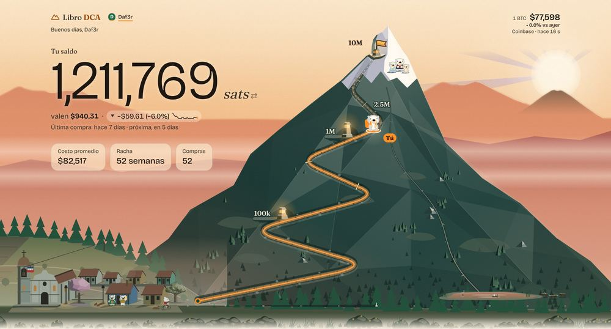 |
| D · A en el fondo y un montículo en el pueblo | las bandas de A y, sobre los campos, un montículo con el mismo degradado | La que vio el dueño: el fondo, bien; el montículo, **montado sobre el pueblo**, con su contorno en diagonal contra el bosque, y el suelo lavado a un gris pálido. 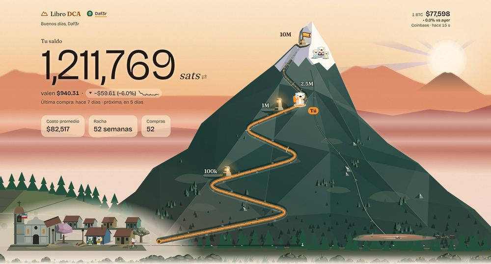 |
| **Lo que quedó** | solo las dos bandas del fondo, más claras | 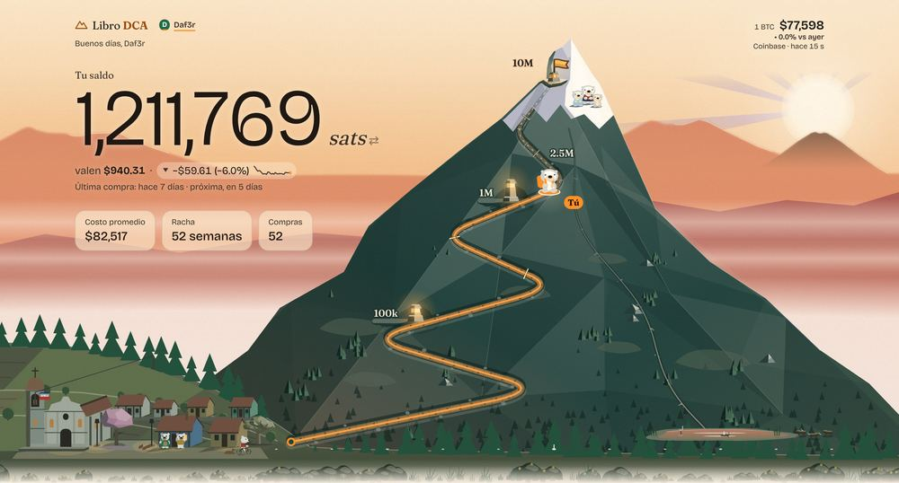 |

El pueblo y su suelo, antes y después: 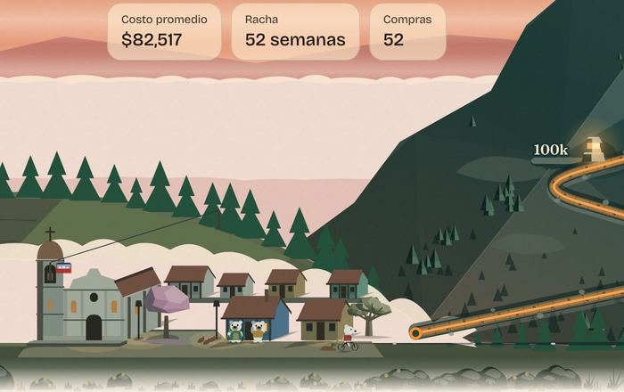 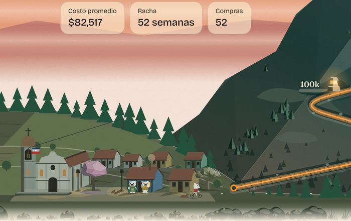

En el teléfono: 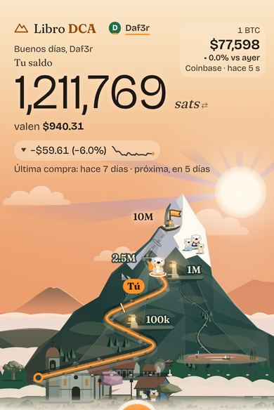 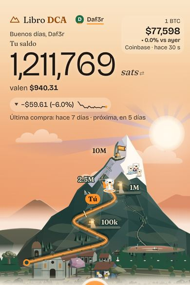

Levantándose (7:15): 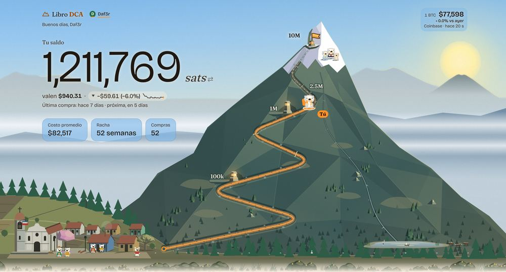

Se descartó además: un degradado lineal para las bandas y otro radial para el pueblo (dos nodos más en todas las fechas del banco) y rectángulos de solo 2.6 anchos (la niebla se quedaba en una cúpula en el centro y no llegaba a los lados: de ahí los seis anchos).

## Medidas
- **Nodos** (`host.querySelectorAll('*')`, escenario `anio`, 6:00 del 10 feb): 390 px, 756 → 755; 1440 px, 812 → 811; 2000 px, 831 → 830; 2560 px, 836 → 835.
- **Animaciones**: ninguna nueva (la neblina no se mueve).
- **Fotogramas por segundo: no medidos.** El banco se corrió con `--rapido` (nodos y animaciones, sin lo blando). El 22B eligió lo opaco también por lo que cuesta pintar una capa translúcida grande; estas dos están quietas y detrás de la montaña, pero a las 6:00 el `<svg>` principal tiene animaciones corriendo y se repinta con ellas: es lo primero que hay que mirar en el teléfono (abajo).
- **Banco** (`node tests/banco_rendimiento.mjs --rapido`, escenario `mil`), antes → después, con un caso nuevo, **«amanecer, neblina»** (6:00; ninguno caía entre las 5:00 y las 7:30):

| Caso | Escena | Valle | Osos | Animaciones a la vista |
|---|---|---|---|---|
| día normal | 833 → 832 | 200 → 195 | 33 | 15 |
| amanecer, neblina | 832 → 831 | 199 → 194 | 33 | 19 |
| día, barre | 831 → 830 | 198 → 193 | 33 | 15 |
| día, gallinas | 831 → 830 | 198 → 193 | 33 | 18 |
| día, perro | 833 → 832 | 199 → 194 | 33 | 16 |
| día, pelota | 833 → 832 | 199 → 194 | 33 | 16 |
| anochecer, fogón | 834 → 833 | 201 → 196 | 33 | 41 |
| noche normal | 831 → 830 | 198 → 193 | 33 | 40 |
| Nochebuena | 903 → 902 | 222 → 217 | 35 | 34 |
| tarde de lluvia | 825 → 824 | 191 → 186 | 33 | 34 |
| noche de lluvia | 823 → 822 | 190 → 185 | 33 | 46 |
| Nochebuena, cohetes | 942 → 941 | 226 → 221 | 35 | 47 |
| 31 dic, cohetes | 908 → 907 | 223 → 218 | 35 | 40 |
| Nochebuena, cena | 911 → 910 | 229 → 224 | 35 | 36 |
| 25 dic, estrenos | 904 → 903 | 222 → 217 | 35 | 26 |
| 31 dic, la espera | 874 → 873 | 223 → 218 | 35 | 28 |
| 1 ene, las doce | 912 → 911 | 226 → 221 | 35 | 29 |
| 6 ene, se guarda | 871 → 870 | 221 → 216 | 35 | 19 |
| antes del alba | 820 → 819 | 187 → 182 | 33 | 38 |
| mediodía, tortillas | 824 → 823 | 191 → 186 | 33 | 13 |
| mediodía, salida de la escuela | 824 → 823 | 191 → 186 | 33 | 13 |
| siesta, la hamaca | 821 → 820 | 188 → 183 | 33 | 13 |
| la vuelta del cantón | 824 → 823 | 190 → 185 | 33 | 16 |
| la fresca | 822 → 821 | 189 → 184 | 33 | 38 |
| lunes, ropa tendida | 831 → 830 | 197 → 192 | 33 | 16 |
| viernes, pupusas | 825 → 824 | 192 → 187 | 33 | 39 |
| Nochebuena 1440 | 962 → 961 | 216 → 211 | 35 | 0 |
| 31 dic 1440 | 968 → 967 | 217 → 212 | 35 | 0 |
| Nochebuena 2560 | 979 → 978 | 229 → 224 | 24 | 0 |
| 31 dic 2560 | 984 → 983 | 230 → 225 | 24 | 0 |

En verde antes y después. La escena pesa un nodo menos en todas las fechas y el valle cinco menos (los trazos de la niebla contaban como valle; las paradas del degradado, no); las animaciones a la vista, las mismas en cada capa. Las `declara` no se bajaron (el banco solo falla si pesa más).

## Decidido (25 nov 2026; no se vuelve a preguntar)
*(Campamento 53B: la neblina dura ahora de 5:00 a 9:00 y vuelve fina por la tarde, y en escritorio hay una bruma baja detrás de las casas del pueblo, por encima del suelo. Ver [53b-neblina-2.md](53b-neblina-2.md).)*
- La neblina es **de degradado, no de planos**: espesa abajo, se deshace hacia arriba. Cambia el «planos opacos, sin degradados» del 22B (nota en cursiva allí).
- **Nada montado sobre el pueblo** (casas, iglesia, vecinos, teleférico, árboles, colinas) **y el suelo sin lavar**: conserva su verde y su textura (pedido del dueño).
- **Clara**, apenas teñida por la hora; ni rosada ni del color del cielo.
- **Quieta**, como en el 22B, y sin niebla de la tarde.
- Un banco nuevo usa `#m-v-mar` y la clase `v-mar`: nada de un degradado por banco.

## Queda a criterio del dueño
El dueño pidió que la niebla del valle fuera «detrás de las casas o bajo ellas, con degradado vertical, y se disuelva antes de la plaza». Aquí se fue a lo seguro: **el banco del pueblo se quitó entero** en vez de recolocarlo, porque en ese hueco del dibujo (los campos, delante del pie de la montaña) cualquier bruma cae sobre el suelo y sobre el bosque. Detrás de las casas queda la loma, y detrás de ella, la neblina. Si la quiere también entre la loma y las casas, hace falta un hueco nuevo en el dibujo (detrás de la fila de casas de atrás, por encima del suelo) y verla con él: no se hizo sin que la vea.

## Pruebas
- `test_lib`: los dos bancos son un `<rect>` cada uno, por debajo del saldo (`techo + 24`), sobran a los lados, llegan al pie y no llevan estilo ni relleno en línea. **Cambia** la prueba del 22B que contaba «dos planos detrás y tres delante con su sombra»; el banco de delante sigue entero por debajo de la milpa.
- `test_ui` (bloque del 22B): dos bancos de degradado detrás de la montaña y **ninguno en el pueblo**, sin desenfoque ni animación; a las 6:00 llena y por debajo del saldo; a las 7:15 se levanta, la de atrás antes; sin niebla de la tarde; también con «ninguno» y en la entrada. **Cambian** los selectores (`.v-mar-cuerpo` ya no existe: `.v-mar-frente`).
- `banco_rendimiento`: el caso de las 6:00.
- Capturas antes y después a 320, 390, 768, 844×390, 1440, 2000 y 2560 px a las 6:00 (10 de febrero); después, además, a las 5:15 y a las 7:15, y a 390 y 1440 px un día de la lluviosa en claro y en oscuro.

## Sin probar aquí
- **iPhone real y Safari/WebKit**: un `radialGradient` con `gradientTransform` en un rectángulo de seis anchos de pantalla, con paradas de `stop-color: color-mix(…)` y `stop-opacity`, puede verse distinto (el fundido de las paradas, alguna banda en la gradación) y costar distinto al pintar. La niebla está quieta, así que solo se pinta al poner la escena y en los pasos de `--v-mar`; aun así, **mirarla en el teléfono a las 6:00 y pasar «Medir este aparato» a esa hora**. Si se viera en bandas o saliera «Lento», lo primero es bajar el rectángulo a tres anchos.
- Una tele (2560 px se probó en el navegador, no en una tele).
- No se corrieron axe (la neblina es un `<rect>` sin texto dentro del dibujo, como antes), la suite completa de `test_ui`, `test_api`, el barrido, la regresión visual ni Lighthouse: los corre el CI.
