# Campamento 53B · La neblina, segunda pasada

Reglas vigentes e índice: [CLAUDE.md](../../CLAUDE.md). Sigue a la [53A](53a-neblina.md) (los dos bancos de degradado detrás de la montaña) y cambia otra cosa del [22B](22b-valle-vivo-parte-2.md): «sin niebla de la tarde». Antes de tocar la escena: [docs/escena.md](../escena.md) y [docs/rendimiento.md](../rendimiento.md).

## El pedido
El dueño vio la 53A y pidió «que mejore la niebla o vea la mejor manera de hacerlo»: que se lea como niebla de verdad y sea de lo mejor de la escena, **sin montarse sobre nada ni lavar el suelo**. La 53A había dejado una pregunta abierta: quitó toda la niebla del pueblo porque en el hueco de antes (los campos) caía sobre el suelo y el bosque.

## Lo hecho (25 nov 2026)
- **Un hueco nuevo en el dibujo: la bruma baja del pueblo** (`arte-pueblo.js: pueblo`, `.v-mar-pueblo`). Un óvalo largo y bajo que se pinta **justo antes de la fila de atrás** de casas: queda detrás de todas las casas, la iglesia, los vecinos, los faroles y los árboles del pueblo, a la altura de los tejados de atrás. Entero **por encima de la terraza** (no toca la terraza, la calle ni la plaza: el suelo queda como siempre) y dentro del ancho del pueblo, algo corrida a la izquierda (se deshace antes de sus extremos, del pie de la montaña y de la salida del sendero). Sin borde: se deshace desde el centro.
  - **Solo en escritorio** (`forma === 'esc'`: desde 1100 px, y no en el teléfono acostado), donde el pueblo queda a la izquierda de la salida. En el teléfono, la tablet y el teléfono acostado detrás de las casas están el pie de la montaña, el bosque de las compras y el sendero: ahí cualquier bruma se monta sobre ellos, y no va.
- **Dos jirones sobre el lomo del banco de atrás** (`arte-valle.js: marDeNiebla`, `.v-mar-jiron`; también solo en escritorio): óvalos quietos, largos y bajos, que rompen la línea recta del banco (uno más alto a la izquierda, otro más bajo a la derecha). Nunca pasan del tope del banco, así que tampoco suben hacia el saldo.
- **Otro ritmo** (`cielo.js: marNiebla(h, f)`; el CSS y el dibujo no cambian con la hora, solo `--v-mar`):
  - **De mañana**: se forma de 5:00 a 6:30, llena el valle hasta las 7:00 y **se levanta poco a poco hasta las 9:00** (antes: 5:00 a 7:30, con media hora para formarse y media para irse). La curva no es recta: espesa pronto y aguanta (lo que le falta para estar llena, al cuadrado), porque a medias la niebla es un velo turbio del color del cielo, justo lo que el dueño no quiere; así pasa poco tiempo a medias (a las 6:00 ya va al 89 %; a las 8:00, al 75 %; a las 8:30, al 44 %).
  - **Al caer la tarde vuelve, fina** (tope `NIEBLA_TARDE` = 0.4): en la época lluviosa, de 16:30 a 18:30 (a ratos, con la llovizna de la tarde, que sale de vez en cuando hasta el atardecer); en la seca, de 17:30 a 19:00. Sube y baja en 45 minutos. **Nunca de noche**: a las 19:00 se encienden las luces del valle (`.v-luces`), que se pintan debajo de los bancos, y la neblina ya se ha ido.
- **Dos degradados** (`montana.js`): `#m-v-mar`, el de los bancos (ahora un óvalo centrado, sin `gradientTransform`: el banco es un rectángulo que sigue otro tanto por debajo de la escena y se ve su mitad de arriba; se ve igual que en la 53A), y `#m-v-jiron`, de dos paradas, sin meseta, para los jirones y la bruma del pueblo (más blandos que un banco). El segundo solo se pone en escritorio.
- Sigue **quieta**: ni una animación nueva; no entra en `FOCOS` ni cuenta como ambiental. Sin `filter`, `blur`, `mix-blend-mode` ni estilos en línea.

## Lo que se probó
Sobre la escena real (6:00 del 10 de febrero). Miniaturas en [docs/pulido-visual/neblina/](../pulido-visual/neblina/) (las de esta pasada empiezan por `2-`).

| | Qué es | Qué pasó |
|---|---|---|
| Antes (53A) | dos bancos detrás de la montaña; el pueblo, sin niebla | 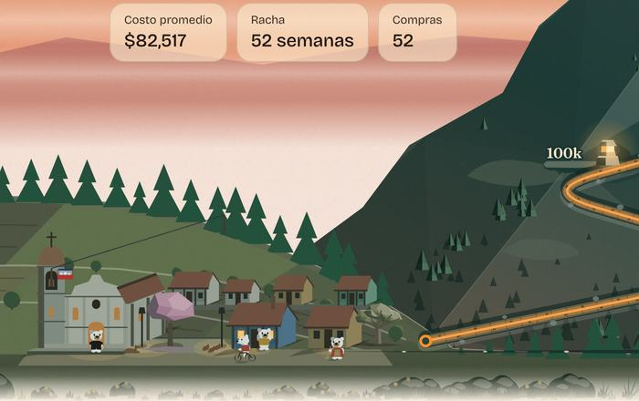 |
| P1 · un hueco nuevo detrás de las casas | un óvalo de bruma antes de la fila de atrás | **Elegida.** Se lee como niebla en la hondonada, las casas quedan nítidas delante y el suelo no se toca. La primera prueba era un halo redondo; quedó más largo y más bajo. 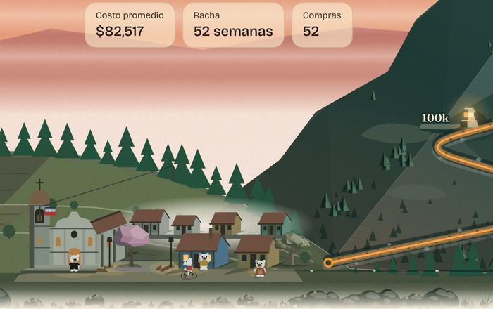 |
| P2 · jirones que cruzan | las dos bandas de ambiente que ya se mueven (`.niebla`), blancas y densas mientras hay neblina | Vistosas, pero son dos rayas blancas sobre las sierras con una franja rosada entre ellas y el banco: **se amontonan** con él. Descartada; las bandas de ambiente se quedan como estaban. De aquí salió la idea de los dos jirones quietos, pegados al lomo del banco. 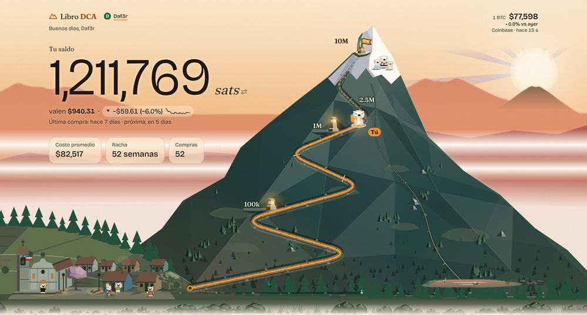 |
| P3 · la bruma del lago | un óvalo de bruma sobre el agua | **Montada**: el lago está al pie de la montaña, entre el bosque de las compras, las vacas y el cayuco; la bruma los tapa a todos. Descartada. 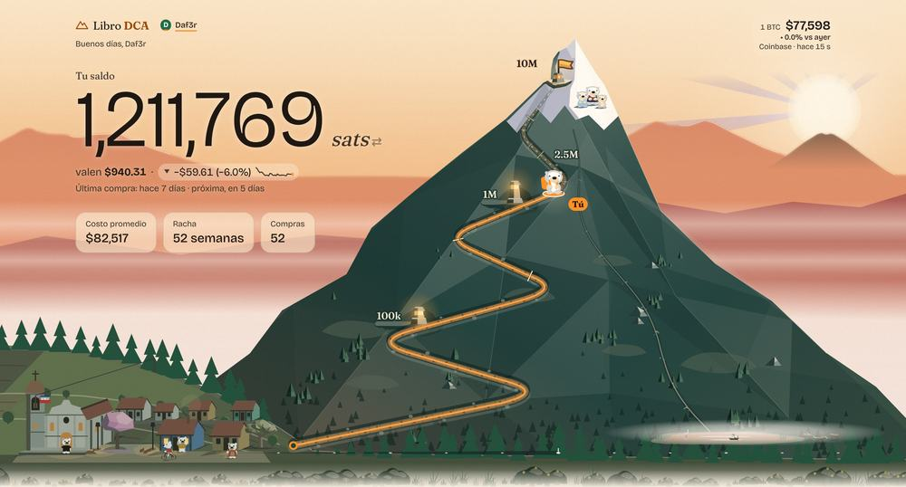 |
| **Lo que quedó** | P1, los dos jirones y el ritmo nuevo |  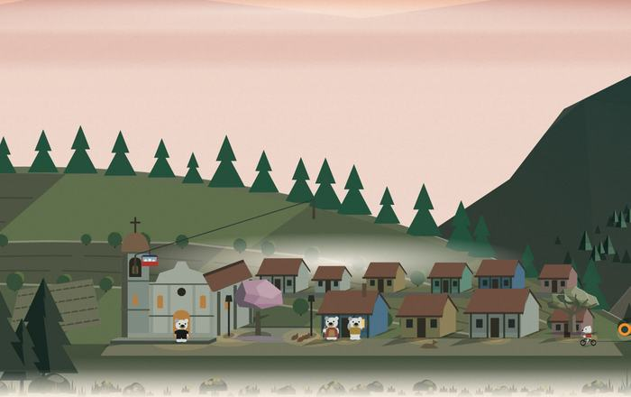 |

La escena entera: 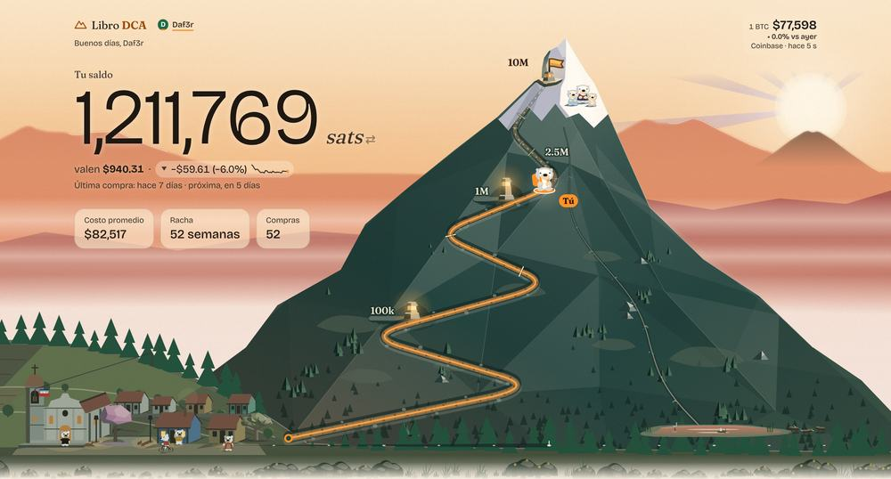 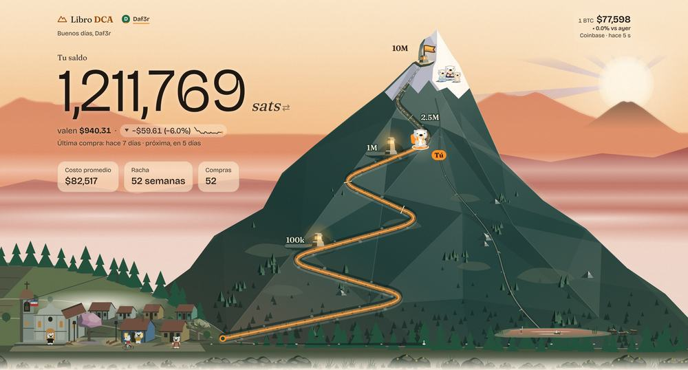

El ritmo: levantándose a las 8:30 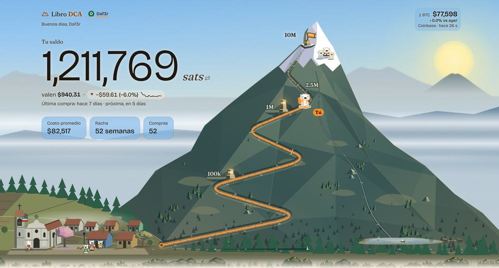 · al anochecer en la seca (18:30) 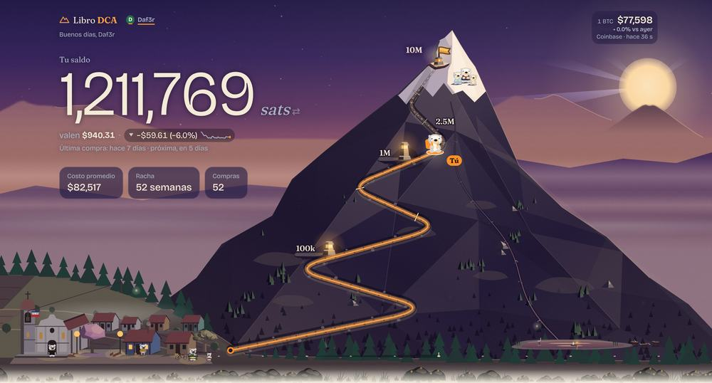 · tras la lluvia (17:30 de julio) 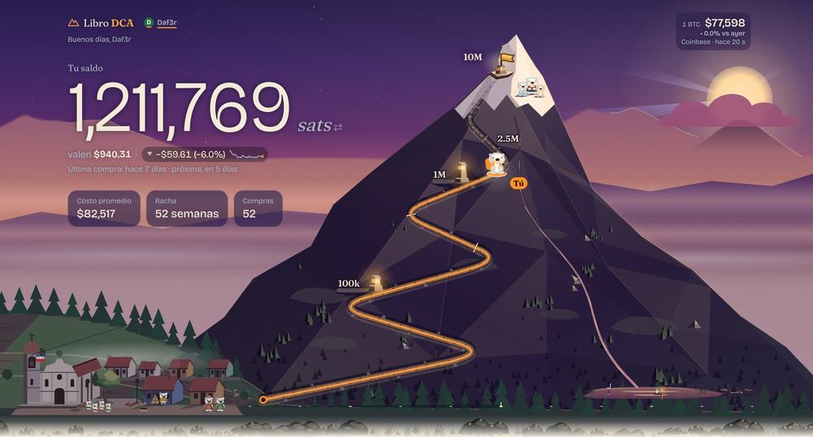

En el teléfono (sin cambios en el dibujo; cambia el ritmo): 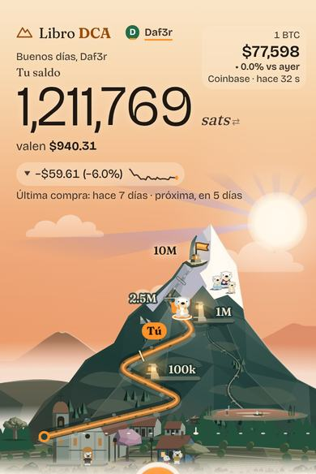

Se descartó además: un solo degradado para todo (con la meseta que necesita un banco, un óvalo pequeño sale con el borde marcado, como una pastilla; con el fundido que necesita un jirón, el banco se queda en un velo rosado), jirones también en el teléfono y la tablet (el banco apenas asoma a los lados de la montaña y los jirones quedaban sueltos sobre los volcanes, como rayas) y una subida recta de la niebla (a las 6:00 iba al 67 %: turbia).

## Medidas
- **Nodos** (`node tests/banco_rendimiento.mjs --rapido`, escenario `mil`, antes → después; en verde las dos veces): **el teléfono no cambia en ningún caso** (día normal 833, amanecer con neblina 831, el pico 943). En pantallas anchas, **+6** (el degradado de los jirones con sus dos paradas, los dos jirones y la bruma del pueblo): Nochebuena a 1440 px, 962 → 968; 31 dic a 1440, 968 → 974; Nochebuena a 2560, 979 → 985; 31 dic a 2560, 984 → 990 (tope 1100). La tablet, como el teléfono: nada nuevo.
- **Animaciones a la vista**: las mismas en cada capa y en cada caso. La neblina no se mueve.
- **Fotogramas por segundo: no medidos** (el banco completo no cabe en el tiempo de aquí; se corrió con `--rapido`). Lo nuevo son tres óvalos pequeños y quietos en pantallas anchas; lo que sí cambia en el teléfono es que los dos bancos están a la vista más horas (hasta las 9:00 y un rato por la tarde). Ver «Sin probar aquí».

## Decidido (25 nov 2026; no se vuelve a preguntar)
- La bruma del pueblo va **detrás de las casas y por encima del suelo**, y **solo donde detrás de las casas no están el sendero ni el bosque** (hoy, escritorio). Nada de bruma sobre el lago.
- Los jirones son **quietos y pegados al banco**; las bandas de ambiente que cruzan no se tiñen de niebla (se amontonan).
- La neblina de la mañana **dura de 5:00 a 9:00** y espesa pronto (a medias es un velo turbio).
- **De noche no hay neblina** (las luces del valle van debajo de ella).
- El teléfono y la tablet **no cargan un nodo más** por la neblina.

## Queda a criterio del dueño
- **La niebla de la tarde** contradice una decisión escrita del 22B («sin niebla de la tarde», con nota en cursiva allí). Se hizo porque el encargo de esta pasada la pedía y el dueño todavía no la ha visto: si no convence, `NIEBLA_TARDE = 0` en `cielo.js` la apaga (y las comprobaciones de la tarde en `test_lib` y `test_ui`).
- **El teléfono y la tablet** no ganan dibujo nuevo, solo el ritmo: en ese tamaño el pueblo está delante del pie de la montaña y del sendero, y no hay un plano libre para la bruma.

## Pruebas
- `test_lib`: el ritmo nuevo de la mañana y la neblina fina de la tarde en las dos épocas (que de 9:00 a 5:00 nunca pasa de fina y que de noche no hay); lo que queda en `<html>` a las 6:00 (`--v-mar` 0.889); los dos jirones (óvalos largos, por debajo del tope del banco; en el teléfono, ninguno); la bruma del pueblo (antes que la fila de atrás, por encima de la terraza, dentro del pueblo; en el teléfono y la tablet, ninguna). **Cambia** la comprobación del 22B que fijaba las horas de 5:00 a 7:30 y «nada por la tarde».
- `test_ui` (bloque del 22B): acepta óvalos y los dos degradados; la hora de «se está levantando» pasa de las 7:15 a las 8:30; **«sin niebla de la tarde» pasa a ser** «vuelve fina por la tarde» (17:30 de octubre) y «a mediodía no hay»; y una página a 1440 px comprueba la bruma del pueblo (detrás de las casas, por encima del suelo, con su degradado) y los dos jirones.
- Capturas: antes y después a 320, 390, 768, 1440, 2000 y 2560 px a las 6:00; después, además, a las 5:15 y a las 7:15 en todos (y 844×390), a las 8:30, 18:30 y 18:45 (390, 1440 y 2000; con mil compras, las luces del valle a las 19:00), y un día de la lluviosa a las 6:00, 7:15 y 17:30 en claro y en oscuro (390 y 1440).

## Sin probar aquí
- **iPhone real y Safari/WebKit**: lo mismo que en la 53A (un `radialGradient` en un rectángulo de seis anchos de pantalla, paradas con `color-mix` y `stop-opacity`), y ahora durante más horas. **Mirarla en el teléfono a las 6:30 y a las 18:30 y pasar «Medir este aparato» a esas horas.**
- La bruma del pueblo y los jirones, en un monitor de verdad y en una tele (se vieron en el navegador a 1440, 2000 y 2560 px).
- Fotogramas por segundo, la suite completa de `test_ui`, `test_api`, el barrido, la regresión visual y Lighthouse: los corre el CI.
